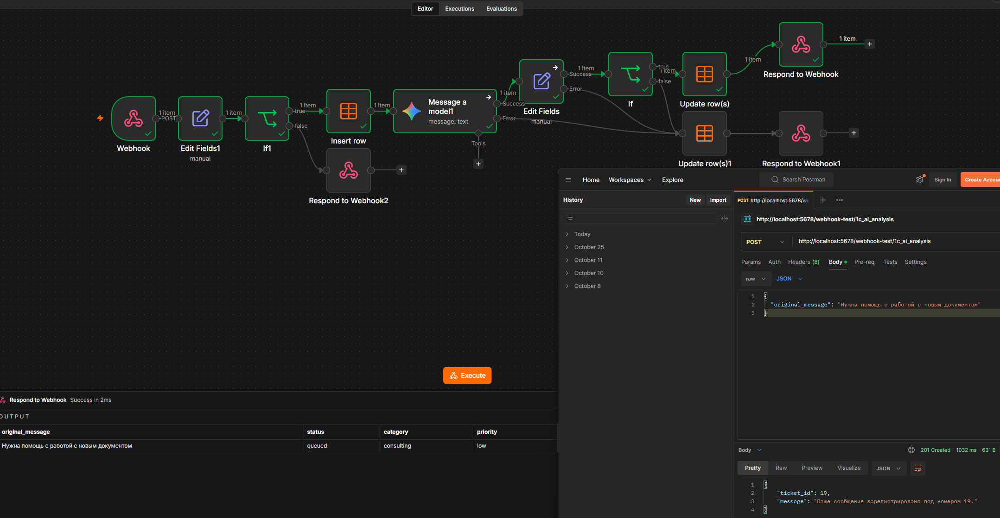
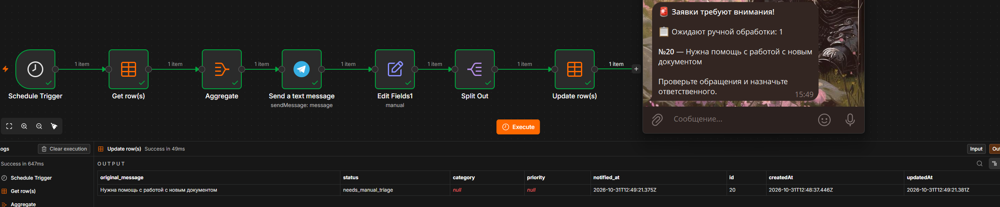
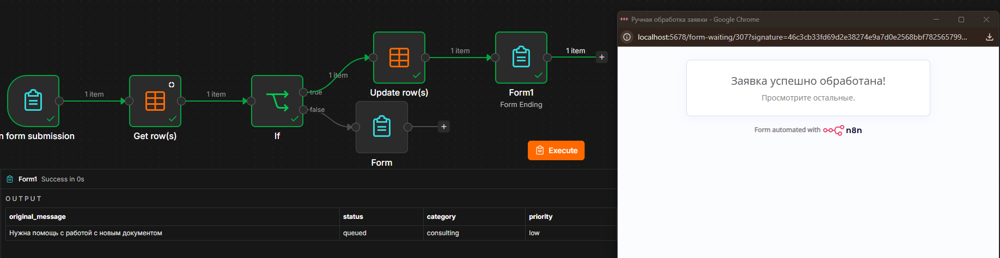

# AI Ticket System

Учебный проект: автоматизация обработки заявок на n8n, запускается локально в Docker.

Три воркфлоу работают вместе. Заявка принимается и классифицируется моделью Gemini. Если классификация не удалась, заявка попадает в ручную очередь. Специалист получает уведомление в Telegram и возвращает заявку в работу через веб-форму.

## Схема процесса

```
POST-запрос ──> [1. AI Ticket Classifier] ──> таблица tickets
                      │
                      ├─ успех:  status = queued, заполнены category и priority
                      └─ сбой модели или неверный ответ:  status = needs_manual_triage

[2. Ticket Queue Monitor]  (по расписанию)
      └─ находит needs_manual_triage без notified_at ──> сообщение в Telegram ──> notified_at

[3. Ticket Manual Triage Form]  (веб-форма специалиста)
      └─ номер заявки + категория + приоритет ──> status = queued
```

## Воркфлоу

Файлы лежат в папке `workflows/`.

1. **AI Ticket Classifier.** Принимает POST-запрос на Webhook с полем `original_message`. Очищает текст и отклоняет пустое сообщение (HTTP 400). Сохраняет заявку в таблицу `tickets` до вызова модели. Отправляет текст в Gemini и проверяет, что категория и приоритет допустимы. При успехе заявка получает статус `queued` (HTTP 201 с номером заявки). При ошибке модели или недопустимом ответе заявка получает статус `needs_manual_triage` и не теряется.
2. **Ticket Queue Monitor.** По расписанию (каждые 5 минут, настраивается) находит заявки со статусом `needs_manual_triage` и пустым `notified_at`. Отправляет в Telegram список в виде «№ — текст обращения». После отправки ставит `notified_at` только тем заявкам, которые вошли в сообщение, поэтому об одной заявке специалист узнаёт один раз.
3. **Ticket Manual Triage Form.** Веб-форма n8n. Специалист вводит номер заявки, выбирает категорию и приоритет из выпадающих списков. Если заявка действительно находится в `needs_manual_triage`, она обновляется и получает статус `queued`. Иначе форма показывает сообщение «Заявка не найдена или уже обработана».

## Стек

n8n (Docker), Data Tables, Gemini API, Telegram Bot API, Webhook, Form Trigger.

## Как запустить

1. Установить и запустить Docker Desktop.
2. В PowerShell выполнить две команды по очереди (вторая вводится одной строкой). Первая создаёт том для данных n8n, вторая запускает контейнер в фоне с автозапуском. Часовой пояс замените на свой:

```
docker volume create n8n_data
```

```
docker run -d --name n8n --restart unless-stopped -p 5678:5678 -e GENERIC_TIMEZONE="Europe/Moscow" -e TZ="Europe/Moscow" -v n8n_data:/home/node/.n8n docker.n8n.io/n8nio/n8n
```

3. Открыть `http://localhost:5678`, создать аккаунт владельца. Пароль сохранить отдельно.
4. Подготовить то, на что ссылаются воркфлоу:
   - Data Table `tickets` с колонками `original_message`, `status`, `category`, `priority` (текст) и `notified_at` (дата).
   - Credential для Gemini (Google Gemini(PaLM) API). Нужен API-ключ, его можно создать на https://aistudio.google.com/api-keys. Доступность Gemini API зависит от региона.
   - Credential для Telegram: токен бота, который создаётся через @BotFather.
5. Импортировать воркфлоу: в редакторе меню `⋯` → Import from file, по очереди все три файла из `workflows/`.
6. После импорта в каждой ноде Data table выбрать свою таблицу `tickets` (идентификаторы из чужого экземпляра не подходят). В нодах Gemini и Telegram выбрать свои credentials. В Telegram-ноде вместо `YOUR_CHAT_ID` вписать свой chat ID.
7. Опубликовать (Publish) все три воркфлоу.

Как узнать chat ID: написать своему боту любое сообщение и открыть `https://api.telegram.org/bot<ТОКЕН>/getUpdates`, найти в ответе `chat` → `id`. Токен бота никому не показывать и не публиковать.

## Как проверить

Отправить POST-запрос (например, из Postman). Тестовый адрес работает, пока в редакторе нажато «Listen for test event», боевой работает после Publish:

- тестовый: `http://localhost:5678/webhook-test/1c_ai_analysis`
- боевой: `http://localhost:5678/webhook/1c_ai_analysis`

Тело запроса (JSON):

```
{ "original_message": "Не проходит платёж в кассе" }
```

Ожидаемый результат: ответ 201 с номером заявки, в таблице `tickets` у заявки проставлены категория и приоритет. Пустое значение `original_message` возвращает 400.

## Принятые решения

- **Сохранение до вызова модели.** Заявка записывается в таблицу раньше обращения к Gemini, поэтому при сбое модели ничего не теряется.
- **Ручная очередь.** При ошибке модели или недопустимом ответе заявка получает статус `needs_manual_triage`. Формат ответа модели проверяется до записи.
- **Отдельная колонка `notified_at`.** Не смешивает жизненный цикл заявки со статусом уведомления и позволяет позже добавить напоминания.
- **Пометка только отправленных заявок.** `notified_at` ставится по списку номеров, вошедших в сообщение, а не по общему фильтру. Так заявка, появившаяся между выборкой и отправкой, не будет помечена без уведомления.
- **Экранирование текста.** Символы `<`, `>`, `&` в тексте заявки заменяются на безопасные коды, иначе Telegram отклоняет сообщение с разметкой HTML.
- **Проверка в форме.** Форма обновляет только заявки со статусом `needs_manual_triage`.

## Известные ограничения

- Работает локально: пока включены компьютер и Docker. Вебхук и форма доступны только на `localhost`.
- Нет аутентификации на вебхуке и форме.
- Текст заявки передаётся в промпт без защиты от prompt injection. Проверка ответа контролирует формат, но не правильность выбора.
- Список категорий задан в двух местах (проверка в классификаторе и выпадающий список формы), менять нужно синхронно.
- При одновременной отправке формы двумя специалистами запись второго блокируется повторной проверкой статуса, но поведение для второго специалиста не проверено.
- Если Telegram недоступен, уведомление повторится при следующем запуске. Возможен дубль, потеря исключена.

## Скриншоты






